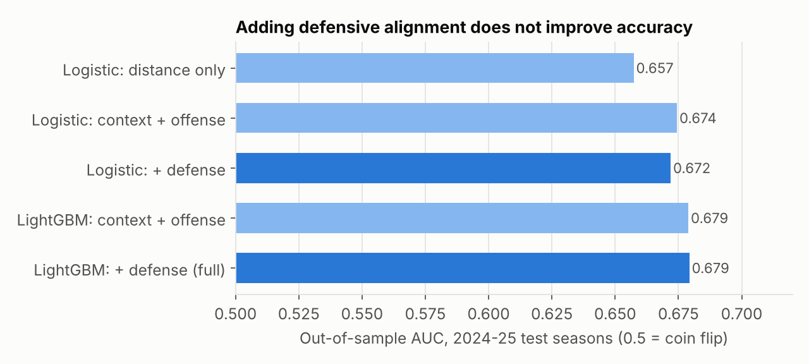

# Does the Defense Matter on 4th Down? An NFL Conversion Model

**[Try the live 4th-down decision calculator](https://atchiangusc.github.io/4th-Down-Model-/)**

Predicts the probability an NFL offense converts a 4th-down attempt, and tests a specific hypothesis: **does knowing the defensive alignment (defenders in the box, number of defensive linemen, DB count) improve the prediction beyond distance, field position, and game situation?**

**Short answer: no.** Across 6,847 plays (2016-2025), a gradient-boosted model with defensive features scores the same out-of-sample as one without them (AUC gain +0.0003, 95% bootstrap CI -0.003 to +0.004). Distance and the run/pass call dominate.

## Data
- **Play-by-play:** nflverse via [`nflreadpy`](https://github.com/nflverse/nflreadpy) (the maintained successor to `nfl_data_py`, which was archived in 2025)
- **Participation (personnel + box count):** 2016-2022 from NFL Next Gen Stats; 2023+ from FTN Data via nflverse (CC-BY-SA 4.0)
- **Sample:** every 4th-down run or pass (punts, field goals, kneels, spikes excluded) that has personnel data: 7,049 attempts, 6,847 after the join

## Features
| Group | Features |
|---|---|
| Distance | yards to go (raw + log) |
| Context | field position, goal-to-go, run vs pass, shotgun, no-huddle, score differential, time remaining, win probability, home, outdoors, Vegas spread |
| Offense | OL / RB / TE / WR counts, formation |
| **Defense** | defenders in box, DL count, DB count, box count minus offensive blockers (OL + TE + RB) |

Personnel strings come in two formats (`4 DL, 2 LB, 5 DB` pre-2023 vs `3 CB, 2 DE, 2 DT, 1 FS, 2 ILB, 1 SS` from FTN), so positions are mapped to groups (DE/DT/NT -> DL, etc.).

## Method
- **Out-of-time split:** train 2016-2023 (5,101 plays), test 2024-2025 (1,746 plays), mimicking how the model would be used on new seasons
- **Ablation:** five models of increasing information, so the value of the defensive features is isolated
- **LightGBM** with a monotone constraint (longer distance can never raise conversion probability), tree count chosen by 5-fold CV grouped by game to prevent leakage between plays in the same game
- **Evaluation:** AUC, Brier score, log loss, calibration, plus a game-level bootstrap for the confidence interval on the defensive-feature gain
- **Interpretation:** TreeSHAP feature attributions

## Results
| Model | AUC | Brier | Brier skill vs. base rate |
|---|---|---|---|
| Logistic: distance only | 0.657 | 0.2255 | 9.0% |
| Logistic: context + offense | 0.674 | 0.2234 | 9.9% |
| Logistic: + defense | 0.672 | 0.2239 | 9.7% |
| LightGBM: context + offense | 0.679 | 0.2211 | 10.8% |
| **LightGBM: + defense (full)** | **0.679** | **0.2212** | **10.8%** |




## Takeaways
1. **Defensive alignment is mostly a reaction to the offense.** Defenses load the box when offenses bring heavy personnel on short yardage, so once the model knows distance and offensive personnel, box count carries little new information.
2. **On 4th and 1-2, runs convert about 70% vs. about 55% for passes**, and that gap holds regardless of how many defenders are in the box relative to blockers.
3. **Distance and the run/pass call are the two biggest drivers** by SHAP, far ahead of any defensive feature.
4. **The model is well calibrated** on unseen seasons: when it says 70%, teams convert about 70% of the time.

## Limitations
- Box count is a snapshot at the snap; it doesn't capture post-snap movement, stunts, or blitzes
- About 7k plays is small for a high-variance outcome; a ceiling around 0.68 AUC is expected because individual 4th-down plays are noisy
- Run vs. pass is an offensive choice included as a feature, so this is a "given the call" model
- 2025 is a partial season

## Part 2: Decision calculator (my model vs. NFL coaches)
`src/decision_model.py` trains two situation-only models (inputs: yards to go, yard line, quarter and clock, score margin):
- **Coach model:** P(an NFL team goes for it), trained on all 20,128 4th downs from 2021-2025 (game-grouped CV AUC 0.96)
- **Conversion model:** P(convert | go for it), trained on 7,003 attempts from 2016-2025 (CV AUC 0.67), with conversion odds forced to never rise as distance grows

Both are precomputed over every distance, yard line, clock bucket, and score bucket, and served by a static web page (`docs/index.html`, hosted with GitHub Pages) with no backend. Main pattern: conversion odds barely change with field position, but coach behavior swings from about 5% (own territory) to about 90% (opponent's 35-45), then falls once a field goal is in range.

Go-for-it rate across all 4th downs rose from 12.7% in 2016 to 23.2% in 2025.

To run the calculator locally:
```bash
python src/decision_model.py
cp outputs/calculator_grid.json docs/ && cd docs && python -m http.server
```

## Project structure
```
src/build_dataset.py    joins play-by-play + participation data, parses personnel
src/train.py            conversion model with defensive features (ablation study)
src/charts.py           README charts
src/decision_model.py   coach go-for-it model + situation conversion model
docs/                   web calculator (GitHub Pages)
outputs/                charts, metrics, saved models
```

## Run it
```bash
pip install -r requirements.txt
python src/build_dataset.py   # downloads and joins data -> data/fourth_downs.parquet
python src/train.py           # trains, evaluates, writes outputs/
python src/charts.py          # regenerates charts
```

## Data credit
Play-by-play and participation data from [nflverse](https://github.com/nflverse). Participation data for 2023 onward is provided by FTN Data via nflverse under CC-BY-SA 4.0.
