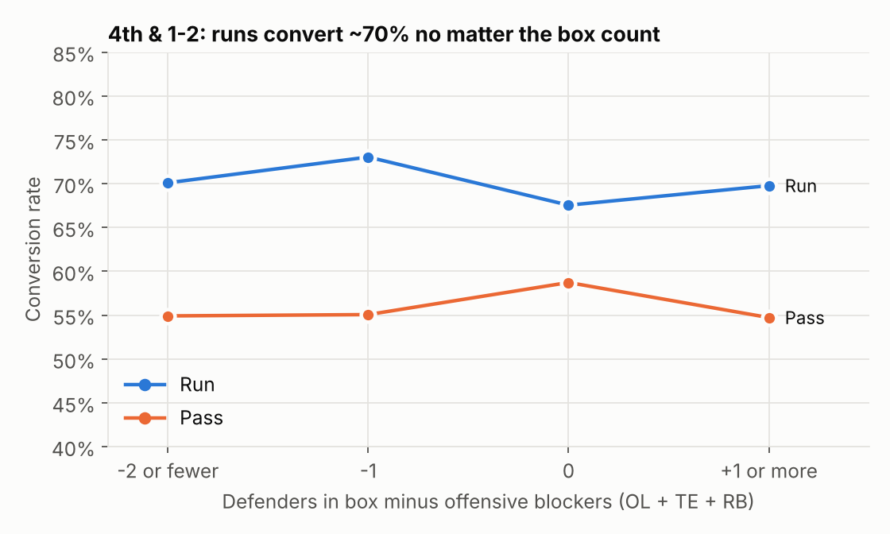
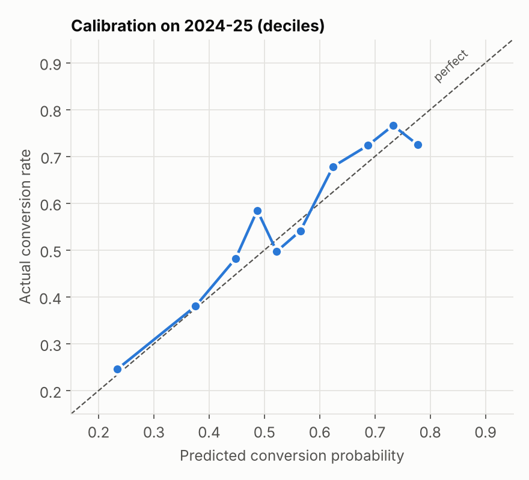
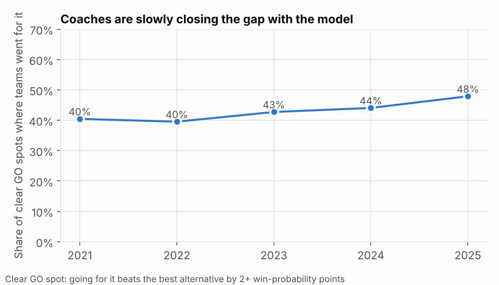

# NFL 4th-Down Decision Model

**[Try the live 4th-down decision calculator](https://atchiangusc.github.io/4th-Down-Model-/)**

An end-to-end analytics project on NFL 4th downs, in two parts:

1. **Does the defense matter?** Does knowing the defensive alignment (defenders in the box, linemen, DBs), team strength, QB quality, or weather improve 4th-down conversion predictions? **Mostly no.** Distance and the run/pass call dominate.
2. **Go, kick, or punt?** A win probability model plus conversion, field goal, and punt models that recommend a decision for any situation and compare it with what NFL coaches actually do. **Coaches go for it in only 48% of spots where the model clearly says go**, though that is up from 40% in 2021.

Everything runs on public nflverse data (2016-2025), and the calculator runs all four models in the browser with no backend.

## Data
- **Play-by-play:** nflverse via [`nflreadpy`](https://github.com/nflverse/nflreadpy) (the maintained successor to `nfl_data_py`, which was archived in 2025): 484k plays, 39,102 regulation 4th downs
- **Participation (personnel + box count):** 2016-2022 from NFL Next Gen Stats; 2023+ from FTN Data via nflverse (CC-BY-SA 4.0)

## Feature engineering
| Group | Features | Notes |
|---|---|---|
| Situation | yards to go, field position, clock, score, timeouts, Vegas spread | |
| Play call | run vs. pass | the offense's choice, so models are "given the call" |
| Offense personnel | OL / RB / TE / WR counts, formation | |
| Defense alignment | defenders in box, DL, DBs, box count minus blockers | two personnel string formats (`4 DL, 2 LB, 5 DB` vs. `3 CB, 2 DE, 2 DT, ...`) mapped to position groups |
| **Team strength** | offense EPA per play, defense EPA per play allowed | see below |
| **QB quality** | primary QB's EPA per dropback | see below |
| **Weather** | wind, temperature, indoors/outdoors | domes set to 0 mph / 70F; bad readings (71 mph) capped |

**Team and QB ratings** (`src/features.py`) use only games played *before* the current one, so nothing leaks from the game being predicted. Each is a decayed, shrunk average:

```
rating = (decayed sum of EPA + K x prior) / (decayed play count + K)
```

Older games fade by 10% per game, and the K pseudo-plays pull small samples toward a prior (league average for teams, below average for unknown QBs, which are usually backups). Sanity check: the top-rated QBs entering their latest 2025 game were Stafford, Love, Purdy, Burrow, and Goff.

**Data cleaning that mattered:**
- **Fake punts and field goals** (264 plays, found from "Punt formation" in the play description) were removed from conversion training. They are surprise plays, and leaving them in made 4th-and-medium attempts from a team's own territory look far easier than they are.
- **Field position is capped at the opponent's 40** in the conversion model. It only matters physically near the goal line; beyond that it mostly reflects which teams choose to go.

## Part 1: What predicts a conversion?
Out-of-time test: train on 2016-2023 (5,076 attempts), test on 2024-2025 (1,707 attempts).

| Model | AUC | Brier | Brier skill vs. base rate |
|---|---|---|---|
| Logistic: distance only | 0.655 | 0.2256 | 9.0% |
| Logistic: context + offense | 0.677 | 0.2228 | 10.1% |
| Logistic: + defense | 0.674 | 0.2236 | 9.8% |
| LightGBM: context + offense | 0.679 | 0.2210 | 10.9% |
| LightGBM: + defense | 0.678 | 0.2214 | 10.7% |
| LightGBM: + team / QB / weather | 0.681 | 0.2207 | 10.9% |
| **LightGBM: everything** | **0.684** | **0.2201** | **11.2%** |

Game-level bootstrap on the test seasons (1,000 resamples):
- Defensive alignment: **-0.001 AUC** (95% CI -0.004 to +0.002)
- Team strength, QB, weather: **+0.002 AUC** (95% CI -0.006 to +0.010)

Neither gain is statistically distinguishable from zero.





**Takeaways**
1. **Defensive alignment is mostly a reaction to the offense.** Defenses load the box when offenses bring heavy personnel on short yardage, so once a model knows distance and offensive personnel, box count adds nothing.
2. **On 4th and 1-2, runs convert about 70% vs. about 55% for passes**, and the gap holds regardless of the box count.
3. **Team and QB quality matter, just not much per play.** Going from a 10th- to a 90th-percentile offense and QB moves a 4th-and-4 from about 48% to 55%. That's real, but small next to the noise of a single play.
4. **The model is well calibrated** on unseen seasons.

## Part 2: Go, kick, or punt?
`src/win_prob.py` and `src/decision_model.py` build the decision engine:

| Model | Method | Data | Accuracy |
|---|---|---|---|
| Win probability | LightGBM, monotone in score and field position | 358k snaps 2016-2024, tested on 40k 2025 snaps | AUC 0.846 on 2025 |
| Conversion (run and pass) | LightGBM with team, QB, weather | 6,739 attempts 2016-2025 | CV AUC 0.683 |
| Coach go-for-it | LightGBM | 20,128 4th downs 2021-2025 | CV AUC 0.959 |
| Coach play call | LightGBM | 4,029 attempts 2021-2025 | CV AUC 0.871 |
| Field goal make | Logistic regression on distance and wind | 6,609 kicks 2020-2025 | 90% at 40 yds, 77% at 50, 54% at 60 |

Each choice is valued in win probability:
- **Go:** chance to convert x WP after a 1st down (average gain for that distance, or a TD), plus the chance to fail x WP with the opponent taking over at the spot
- **Field goal:** make chance x WP after +3 and a kickoff, plus the miss chance x WP with the opponent at the spot of the kick
- **Punt:** WP with the opponent at the average field position after a punt from that spot

The calculator also shows the **break-even conversion rate**: the chance of converting at which going for it ties the best alternative.

**Example:** 4th and 1 at your own 30, first quarter, tied. Going for it wins if the chance to convert is above **55%**. The model estimates **71%**, yet only **17%** of coaches go for it.

**Back-test, 2021-2025:** across every 4th down, the model's call was compared with what the team did.



- In clear go spots (going for it beats the alternative by 2+ win-probability points), teams went for it **40% of the time in 2021, rising to 48% in 2025**
- In clear kick or punt spots, teams went for it only **2.5%** of the time, so coaches rarely make the opposite mistake
- 2025's most aggressive teams in clear go spots: Dallas (65%), Green Bay (62%), Philadelphia (62%). Least aggressive: the Chargers (20%), Seattle (26%), Houston (29%)

**Modeling decisions worth knowing:**
- **The Vegas spread is a WP feature,** set to "even" in the calculator unless you enter one. Without it, the model credits having the ball for being the better team. Adding it raised 2025 AUC from 0.818 to 0.846.
- **I tested training WP on drive starts only** to remove "this offense is rolling" information from mid-drive snaps. Late-game drive starts were too rare (about 30 per situation), and that model was badly overconfident, so the final model uses all snaps.
- **The JavaScript engine is tested against Python** (`src/test_parity.js`): all four models match to within 0.0004 percentage points. A first version failed because LightGBM splits at a threshold of -1e-35, and rounding that to -0 sent zeros down the wrong branch.

## Limitations
- **Selection bias:** teams mostly go for it when they like their chances, which can make past conversion rates look better than they'd be on a random call. This is the main caveat of every 4th-down model, and it likely makes this one somewhat aggressive in a team's own territory.
- **Simplified outcomes:** a successful conversion gains the average yards for that distance; a punt nets the average result from that spot; kickoffs start at the 30. Calls within 1 win-probability point are labeled close calls.
- **The win-probability back-test totals** (about 0.6 wins per team-season "left on the table") treat model estimates as exact, so they overstate the true cost.
- **Box count** is a snapshot at the snap: no post-snap movement, stunts, or blitzes.
- 2025 is a partial season.

## Project structure
```
src/features.py         play-level data + team strength, QB, weather features (leakage-free)
src/build_dataset.py    joins play-by-play + participation data, parses personnel
src/train.py            Part 1: conversion models and feature ablation study
src/win_prob.py         win probability, field goal, punt and gain models
src/decision_model.py   coach, conversion and play-call models; back-test; browser export
src/test_parity.js      checks the browser engine against Python predictions
src/charts.py           README charts
docs/                   calculator: index.html, engine.js, exported models (GitHub Pages)
outputs/                charts, metrics, saved models, back-test results
```

## Run it
```bash
pip install -r requirements.txt
python src/features.py        # downloads play-by-play, builds features -> data/plays.parquet
python src/build_dataset.py   # joins personnel data -> data/fourth_downs.parquet
python src/train.py           # Part 1 study
python src/win_prob.py        # win probability + kicking/punting models
python src/decision_model.py  # decision models, back-test, calculator export
python src/charts.py          # charts
cp outputs/calculator_models.json docs/ && node src/test_parity.js
cd docs && python -m http.server   # open http://localhost:8000
```

## Data credit
Play-by-play and participation data from [nflverse](https://github.com/nflverse). Participation data for 2023 onward is provided by FTN Data via nflverse under CC-BY-SA 4.0.
