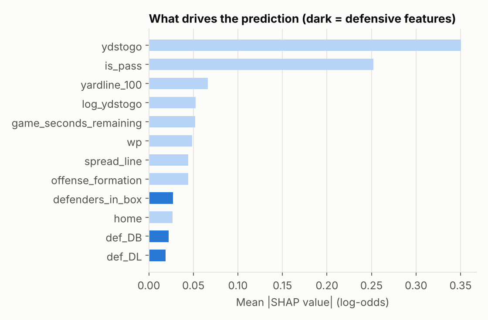

# NFL 4th-Down Decision Model

**[Try the live 4th-down calculator](https://atchiangusc.github.io/4th-Down-Model-/)**

I wanted to answer two questions about 4th downs in the NFL:

1. **Does the defense on the field change whether an offense converts?** I expected box count and the number of defensive linemen to matter. They don't. Once you know the distance and whether it's a run or a pass, the defense adds almost nothing.
2. **Are coaches making the right call?** I built a win probability model to compare going for it, kicking, and punting. In spots where going for it is clearly the better call, coaches only go for it 48% of the time. That's up from 40% in 2021, so they're getting better, but slowly.

Everything uses free public NFL data from 2016 to 2025. The calculator runs all of the models right in your browser.

## The data
- **Play-by-play:** every play since 2016 from [nflverse](https://github.com/nflverse), loaded with [`nflreadpy`](https://github.com/nflverse/nflreadpy). That's 484k plays and 39,102 fourth downs.
- **Who was on the field:** personnel and box counts for each play. 2016-2022 comes from NFL Next Gen Stats, and 2023 on comes from FTN Data through nflverse.

## What I fed the models
| Group | What's in it |
|---|---|
| Situation | yards to go, field position, clock, score, timeouts, Vegas spread |
| Play call | run or pass |
| Offense personnel | how many linemen, running backs, tight ends, receivers, plus the formation |
| Defense | defenders in the box, defensive linemen, defensive backs, box count minus blockers |
| Team strength | how efficient the offense and defense have been lately (EPA per play) |
| Quarterback | how efficient the starting QB has been lately (EPA per dropback) |
| Weather | wind, temperature, and whether it's indoors |

**Team and QB ratings** only use games played before the one being predicted, so the model never gets a peek at the result. Recent games count more than older ones, and players with only a few plays get pulled toward an average so one big game doesn't make a backup look like a star. As a check, the top-rated QBs going into their latest 2025 game were Stafford, Love, Purdy, Burrow, and Goff.

**Cleanup that made a real difference:**
- **Fake punts and fake field goals** (264 plays) were mixed in with normal attempts. They work because nobody expects them, so they made 4th downs deep in a team's own territory look much easier than they are. I took them out.
- **The personnel data changed formats in 2023.** Older seasons say `4 DL, 2 LB, 5 DB` and newer ones list exact positions like `2 DE, 2 DT, 3 CB`. I mapped both to the same groups.

## Part 1: What predicts a conversion?
I trained on 2016-2023 and tested on 2024-2025, so every test play is from a season the model never saw.

| Model | AUC | Brier | Better than guessing the average by |
|---|---|---|---|
| Logistic: distance only | 0.655 | 0.2256 | 9.0% |
| Logistic: situation + offense | 0.677 | 0.2228 | 10.1% |
| Logistic: + defense | 0.674 | 0.2236 | 9.8% |
| LightGBM: situation + offense | 0.679 | 0.2210 | 10.9% |
| LightGBM: + defense | 0.678 | 0.2214 | 10.7% |
| LightGBM: + team / QB / weather | 0.681 | 0.2207 | 10.9% |
| **LightGBM: everything** | **0.684** | **0.2201** | **11.2%** |

To check whether the small differences were real, I resampled the test games 1,000 times:
- Adding the defense: **-0.001 AUC** (95% range -0.004 to +0.002)
- Adding team, QB, and weather: **+0.002 AUC** (95% range -0.006 to +0.010)

Both ranges include zero, so neither one is a real improvement.





**What I took away**
1. **The defense lines up based on what the offense shows.** Heavy personnel on 4th and 1 gets a loaded box. So once the model knows the distance and the offense's personnel, the box count doesn't tell it anything new.
2. **On 4th and 1-2, runs convert about 70% of the time and passes about 55%,** no matter how many defenders are in the box.
3. **Better teams and QBs do convert more, just not by much.** Going from a 10th-percentile offense and QB to a 90th-percentile one moves 4th and 4 from about 48% to 55%.
4. **The probabilities hold up.** When the model says 70%, teams convert about 70% of the time.

## Part 2: Go for it, kick, or punt?
To compare choices, I needed to know how each one changes a team's chances of winning.

| Model | What it does | Data | How well it works |
|---|---|---|---|
| Win probability | chance the team with the ball wins | 358k plays 2016-2024, tested on 2025 | AUC 0.846 on 2025 |
| Conversion | chance a run or pass converts | 6,739 attempts | AUC 0.683 |
| Coach decision | chance a coach goes for it | 20,128 fourth downs 2021-2025 | AUC 0.959 |
| Coach play call | chance a coach passes | 4,029 attempts 2021-2025 | AUC 0.871 |
| Field goals | chance a kick is good | 6,609 kicks 2020-2025 | 90% at 40 yards, 77% at 50, 54% at 60 |

How each choice gets scored:
- **Go for it:** if they convert, they get a first down (or a touchdown). If they fail, the other team gets the ball right there.
- **Field goal:** if it's good, they're up 3 and kick off. If it misses, the other team gets the ball at the spot of the kick.
- **Punt:** the other team gets the ball at the average spot a punt from there ends up.

The calculator also shows the **break-even rate**: how likely a conversion has to be for going for it to beat the next best option.

**Example:** 4th and 1 at your own 30, first quarter, tied. Going for it is the right call if you convert more than **55%** of the time. Teams convert about **71%** there, but only **17%** of coaches go for it.

**How coaches did, 2021-2025:** I ran the model on every 4th down and compared its call with what the team actually did.


- When going for it was clearly better (by 2+ points of win probability), teams went for it **40% of the time in 2021 and 48% in 2025**
- When kicking or punting was clearly better, teams went for it only **2.5%** of the time, so coaches almost never make the opposite mistake
- Most willing to go in those spots in 2025: Dallas (65%), Green Bay (62%), and Philadelphia (62%). Least willing: the Chargers (20%), Seattle (26%), and Houston (29%)

**Calls I had to make along the way**
- **I added the Vegas spread to the win probability model.** Without it, the model mixed up "has the ball" with "is the better team." Adding it raised accuracy on 2025 from 0.818 to 0.846. The calculator assumes an even matchup unless you enter a spread.
- **I tried a version trained only on the first play of each drive,** to strip out the "this offense is on a roll" effect. Late in games there wasn't enough data, and that version was way too confident, so I didn't use it.
- **I tested the calculator against the Python models.** All four match to within 0.0004 percentage points. The first version didn't match: rounding turned one tiny split value into zero and sent some plays down the wrong branch.

## What it can't do
- **Teams mostly go for it when they like their chances.** That makes past conversion rates look a little better than a random attempt would be, so the model is probably somewhat too aggressive in a team's own territory.
- **Some outcomes are simplified.** A conversion gains the average yards for that distance, a punt lands at the average spot, and kickoffs start at the 30. Anything within 1 point of win probability is labeled a close call.
- **The "wins left on the table" number** (about 0.6 per team per season) assumes the model is exactly right, so the real number is smaller.
- **Box count is taken at the snap.** It doesn't see blitzes or players moving after the snap.
- 2025 is still in progress.

## What's in the repo
```
src/features.py         loads the data and builds the team, QB, and weather features
src/build_dataset.py    joins plays with who was on the field
src/train.py            Part 1: compares the conversion models
src/win_prob.py         win probability, field goal, and punt models
src/decision_model.py   coach models, the back-test, and the export for the calculator
src/test_parity.js      checks the calculator against the Python models
src/charts.py           makes the charts
docs/                   the calculator (index.html, engine.js, model files)
outputs/                charts, results, and saved models
```

## Run it yourself
```bash
pip install -r requirements.txt
python src/features.py        # downloads the data and builds features
python src/build_dataset.py   # joins in personnel data
python src/train.py           # Part 1
python src/win_prob.py        # win probability and kicking models
python src/decision_model.py  # coach models, back-test, calculator export
python src/charts.py          # charts
cp outputs/calculator_models.json docs/ && node src/test_parity.js
cd docs && python -m http.server   # then open http://localhost:8000
```

## Data credit
Play-by-play and personnel data from [nflverse](https://github.com/nflverse). Personnel data from 2023 on is from FTN Data through nflverse, under CC-BY-SA 4.0.
